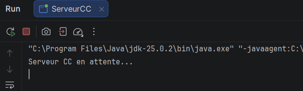
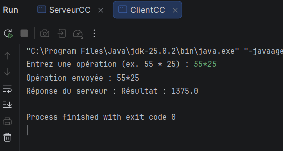
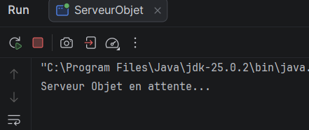
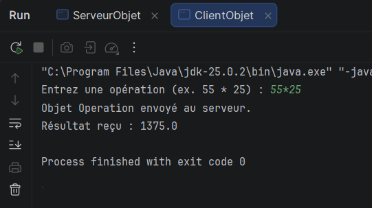

# TP2 — Développement d'applications réparties

**Thème :** Les sockets en mode connecté TCP : échange de chaînes de caractères et d'objets.

**Étudiant :** Nom et Prénom  
**Classe :** LSI3  
**Environnement :** Java JDK 8 ou supérieur, IntelliJ IDEA, Git et GitHub.

---

## 1. Présentation du TP

Ce TP a pour objectif de mettre en pratique la communication entre un client et un serveur à l'aide des sockets TCP en Java.

Il est composé de deux activités :

- **Activité 2-1 :** Échange de chaînes de caractères (CC) entre Client/Serveur.
- **Activité 2-2 :** Échange d'objets Java entre Client/Serveur.

## 2. Structure du projet

Le projet est organisé en deux packages :

```text
NomPrenom_LSI3_DevAppReparties/
│
├── src/
│   ├── clientPackage/
│   │   ├── ClientCC.java
│   │   ├── ClientObjet.java
│   │   └── Operation.java
│   │
│   └── serverPackage/
│       ├── ServeurCC.java
│       └── ServeurObjet.java
│
├── captures/
│
└── README.md
```

## 3. Activité 2-1 : Échange de chaînes de caractères

### Objectif

Permettre au client d'envoyer une opération arithmétique complète au serveur sous forme d'une chaîne de caractères.

### Fonctionnement

1. Le client saisit une opération arithmétique.
2. Le client valide la syntaxe de l'opération.
3. Le client envoie l'expression au serveur.
4. Le serveur reçoit et analyse l'expression.
5. Le serveur effectue le calcul demandé.
6. Le serveur renvoie le résultat au client.
7. Le client affiche le résultat reçu.

### Classes utilisées

- `ClientCC.java`
- `ServeurCC.java`

### Technologies utilisées

- `Socket` et `ServerSocket`
- `BufferedReader`
- `InputStreamReader`
- `PrintWriter`
- `Pattern` et `Matcher`

### Captures d'écran

**Exécution du serveur :**



**Exécution du client :**



## 4. Activité 2-2 : Échange d'objets Java

### Objectif

Permettre au client d'envoyer un objet Java contenant les informations nécessaires à une opération arithmétique.

### Fonctionnement

1. Le client saisit une opération arithmétique.
2. Le client valide la syntaxe.
3. Le client crée un objet de la classe `Operation`.
4. L'objet est envoyé au serveur à l'aide de `ObjectOutputStream`.
5. Le serveur reçoit l'objet avec `ObjectInputStream`.
6. Le serveur récupère les deux opérandes et l'opérateur.
7. Le serveur effectue le calcul.
8. Le serveur renvoie le résultat au client.
9. Le client reçoit et affiche le résultat.

### Classe Operation

La classe `Operation` implémente l'interface `Serializable` afin de permettre la sérialisation et la transmission de l'objet à travers le réseau.

Elle contient trois attributs :

- `operande1` : premier opérande.
- `operateur` : opérateur arithmétique.
- `operande2` : deuxième opérande.

### Classes utilisées

- `Operation.java`
- `ClientObjet.java`
- `ServeurObjet.java`

### Technologies utilisées

- `Socket` et `ServerSocket`
- `ObjectInputStream`
- `ObjectOutputStream`
- `Serializable`

### Captures d'écran

**Exécution du serveur :**



**Exécution du client :**



## 5. Tests effectués

Les opérations arithmétiques prises en charge sont :

| Opération | Résultat |
|---|---:|
| 55 * 25 | 1375 |
| 100 + 25 | 125 |
| 100 - 25 | 75 |
| 100 / 4 | 25 |

Les tests de validation comprennent également :

- Le rejet des expressions incorrectes.
- Le rejet des opérateurs invalides.
- La gestion de la division par zéro.

## 6. Conclusion

Ce TP m'a permis de comprendre et de mettre en pratique la communication entre applications distribuées à travers les sockets TCP en Java.

J'ai appris à utiliser les flux de caractères pour échanger des chaînes de caractères, ainsi que les flux d'objets pour transmettre des objets Java grâce à l'interface `Serializable`.

Ce travail m'a également permis de mieux comprendre la gestion des flux d'entrée et de sortie, la sérialisation des objets et le traitement des opérations côté serveur.